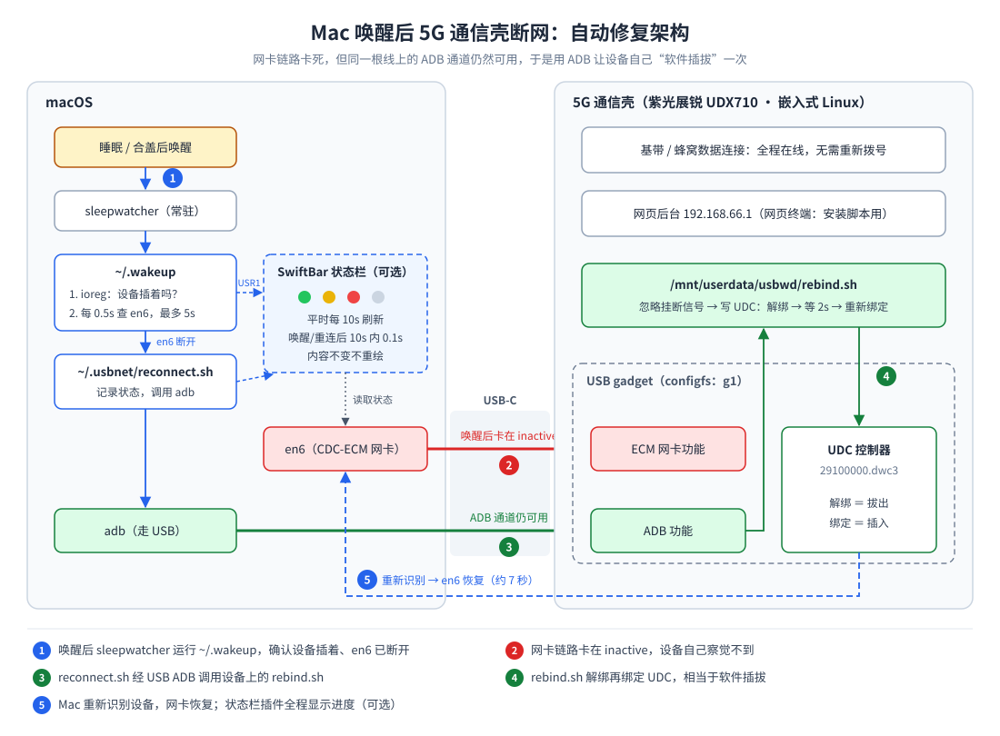
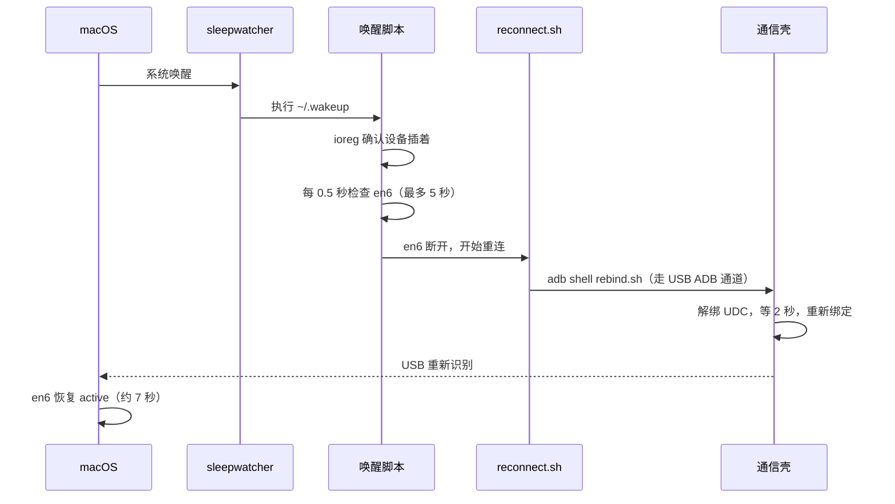

# Mac 唤醒后 USB 5G 通信壳断网的自动修复

把改装过的 5G 通信壳（数源 Soyealink，紫光展锐 UDX710 芯片）通过 USB-C 接到 Mac 当网卡用时，Mac 每次从睡眠或合盖中唤醒后都会断网，只能手动拔插恢复。

这个项目找到了断网的根源，并用一套小脚本实现**唤醒后自动恢复**（约 7 秒），全程不用碰数据线。另外附带一个可选的**状态栏插件**，实时显示连接状态和重连进度。



---

## 目录

- [症状](#症状)
- [适用条件](#适用条件)
- [问题根源](#问题根源)
- [修复原理](#修复原理)
- [安装：模块端](#安装模块端)
- [安装：Mac 端](#安装mac-端)
- [附加功能：状态栏可视化](#附加功能状态栏可视化)
- [资源占用](#资源占用)
- [日志与文件](#日志与文件)
- [故障排查](#故障排查)
- [卸载](#卸载)
- [注意事项](#注意事项)

---

## 症状

- 通信壳插在 Mac 上，平时上网正常。
- Mac 睡眠或合盖后再唤醒，网络断开。
- `ifconfig en6` 显示 `status: inactive`，没有 IP 地址。
- 在 Mac 上执行 `ifconfig en6 down && ifconfig en6 up` 或续租 DHCP 都无效，只有物理拔插能恢复。

## 适用条件

| 项目 | 本方案的环境 | 怎么确认 |
|---|---|---|
| Mac | Apple Silicon MacBook Air | — |
| 设备 | 数源 5G 通信壳，UDX710，系统信息里显示为 `Hi-SOYEADorado-…`（USB VID `0x1782`） | `system_profiler SPUSBHostDataType` |
| USB 模式 | **CDC-ECM**（NCM 模式在此组合下几分钟就会掉线） | 设备后台「USB模式」 |
| 设备 root shell | 改装固件的网页后台自带「网页终端」 | 浏览器打开 `http://192.168.66.1` |
| USB ADB | 设备通过 USB 暴露 ADB 功能 | `adb devices -l` 能看到带 `usb:` 的设备 |
| USB gadget | configfs 下有 gadget（本机为 `g1`），UDC 为 `29100000.dwc3` | `ls /sys/kernel/config/usb_gadget/`、`ls /sys/class/udc/` |
| 可写持久分区 | `/mnt/userdata`（ubifs，重启后保留） | `mount` |

其他基于 Linux USB gadget、并且同时暴露 ECM 网卡和 ADB 的随身 Wi-Fi / 5G 模块，原理上也适用，但未经测试。

---

## 问题根源

通信壳内部跑的是嵌入式 Linux，它用 USB gadget 机制把自己同时模拟成两个 USB 功能：一个 **CDC-ECM 网卡**（Mac 上的 en6）和一个 **ADB 调试通道**。

排查时逐一验证并排除了几种常见猜测：

| 假设 | 验证方法 | 结果 |
|---|---|---|
| Mac 端网卡只是没刷新 | Mac 上 `ifconfig en6 down/up`、续租 DHCP | 仍是 `inactive`，**排除** |
| 换个网卡协议就好了 | 后台切换到 NCM 模式 | 正常使用几分钟就掉线，更糟，**排除** |
| 设备跟着 Mac 休眠、醒不过来 | 在设备上加唤醒锁（`/sys/power/wake_lock`）并每分钟写心跳日志 | 设备全程醒着，唤醒后照样断网，**排除** |
| Mac 睡眠时切断了 USB 供电、设备重启 | 日志里记录设备开机时长 | 开机时长连续增长，没有重启，**排除** |
| 整个 USB 连接都卡死了 | 断网时运行 `adb devices` | 设备仍在列表中，ADB 通道正常，**排除** |

剩下最符合所有现象的解释是：**卡住的只是网卡的"链路状态"。**

CDC-ECM 网卡通过一个专门的通知通道告诉主机"网线已连接"。Mac 唤醒后，网卡驱动把链路重置为"断开"，等设备再发一次"已连接"通知；而设备那边 USB 状态一直是 `configured`，觉得什么都没发生，也就不会再发。双方互相等待，en6 就停在 `inactive`。

> 这一机制是根据上述现象推断的，没有抓包验证，但它能解释所有观察结果：Mac 端怎么刷新都没用（驱动还在等通知）；物理拔插有用（重新连接时设备会走完整初始化，自然会发出通知）。

另外，Mac 端也没法直接复位这个设备：系统网卡驱动独占了它，普通程序打开设备会得到 `kIOReturnExclusiveAccess`（`e00002c5`）错误。

---

## 修复原理

既然网卡链路卡死、ADB 通道却完好，那就**用 ADB 让设备自己"拔插"一次**：在设备上把 USB gadget 从 UDC 控制器上解绑，再重新绑定。Mac 会认为设备被拔出又插入，重新识别后链路恢复。



几个关键点：

- **为什么 ADB 还能用**：ADB 和网卡是同一 USB 设备上的两个独立功能，各用各的数据通道。ADB 不依赖网卡的链路通知，所以网卡卡死时它不受影响。
- **为什么脚本能活过自己造成的断线**：解绑的瞬间 ADB 会话也会断开，设备会给 adb 启动的进程发挂断信号。`rebind.sh` 开头的 `trap "" HUP INT TERM` 让它忽略这个信号，保证"重新绑定"一定执行。直接用 `nohup … &` 的写法实测会被一起杀掉。
- **为什么不用重新拨号**：解绑和绑定只动 USB 这一层，基带和蜂窝数据连接一直在线，所以恢复很快。
- **为什么脚本放在 Mac 端触发**：设备那边察觉不到 Mac 的睡眠和唤醒（USB 状态全程是 `configured`），只有 Mac 自己知道什么时候醒来、网卡是不是断了。

---

## 安装：模块端

以下操作在设备的 root shell 里进行，用网页后台的「网页终端」即可。

### 1. 确认环境

```sh
whoami                                    # 应为 root
ls /sys/class/udc/                        # UDC 控制器名，例如 29100000.dwc3
ls /sys/kernel/config/usb_gadget/         # gadget 名，例如 g1
cat /sys/kernel/config/usb_gadget/*/UDC   # 当前绑定的控制器
mount | grep userdata                     # 确认 /mnt/userdata 可读写
```

### 2. 放置 `rebind.sh`

`rebind.sh` 会自动识别 UDC 和 gadget 的名字，不用手动修改。任选一种方式放到设备上：

**方式 A：从 Mac 用 adb 推送**（推荐）

```bash
adb push device/rebind.sh /mnt/userdata/usbwd/rebind.sh
adb shell chmod +x /mnt/userdata/usbwd/rebind.sh
```

**方式 B：在网页终端里粘贴**

```sh
mkdir -p /mnt/userdata/usbwd
cat > /mnt/userdata/usbwd/rebind.sh << 'EOF'
（把 device/rebind.sh 的内容粘贴到这里）
EOF
chmod +x /mnt/userdata/usbwd/rebind.sh
```

### 3. 测试

在 Mac 上先记下设备当前的 `transport_id`，再触发一次：

```bash
adb devices -l                                   # 记下 transport_id
adb -s <序列号> shell /mnt/userdata/usbwd/rebind.sh
sleep 10
adb devices -l                                   # transport_id 应该加 1
```

`transport_id` 变了，说明设备确实重新连接过一次。设备上的执行记录可以这样看：

```sh
cat /mnt/userdata/usbwd/rebind.log
```

正常的记录包含 `unbind ok` 和 `bind ok`。

---

## 安装：Mac 端

### 1. 查出两个参数

```bash
adb devices -l                          # 第一列就是 SERIAL
networksetup -listallhardwareports      # 通信壳那一项的 Device 就是 IF，例如 en6
```

如果还没有 adb：`brew install --cask android-platform-tools`。

### 2. 运行安装脚本

```bash
git clone <本仓库地址>
cd mac-usb-5g-wake-fix
./install.sh
```

它会做这些事：

1. 安装 `sleepwatcher` 和 `android-platform-tools`（如果还没装）。
2. 创建 `~/.usbnet/config`（从 `mac/config.example` 复制）。
3. 安装 `~/.usbnet/reconnect.sh` 和唤醒脚本 `~/.wakeup`（原有的 `~/.wakeup` 会备份为 `~/.wakeup.bak`）。
4. 启动 sleepwatcher 服务（开机自启）。

### 3. 填写配置

```bash
open -e ~/.usbnet/config
```

至少要把 `SERIAL` 和 `IF` 改成上面查到的值。各项含义：

| 参数 | 含义 | 默认值 |
|---|---|---|
| `SERIAL` | 设备序列号 | 必填 |
| `IF` | Mac 上的网卡名 | `en6` |
| `ADB` | adb 路径，Intel Mac 一般是 `/usr/local/bin/adb` | `/opt/homebrew/bin/adb` |
| `DEVICE_SCRIPT` | 设备上 `rebind.sh` 的路径 | `/mnt/userdata/usbwd/rebind.sh` |
| `WEBUI` | 设备后台地址 | `http://192.168.66.1` |
| `WINDOW` | 唤醒或重连后高速刷新持续的秒数 | `10` |
| `FAST` | 高速刷新间隔（秒） | `0.1` |
| `SLOW` | 平时刷新间隔（秒） | `10` |

后三项只影响状态栏插件。

### 4. 测试

```bash
~/.wakeup; tail -n 3 ~/.usb-wake.log
```

网络正常时应看到「网络正常，跳过」。然后合盖至少 3 分钟，打开后什么都不做，十秒左右网络应自动恢复，日志里会出现：

```
网络断开
开始重连（自动）
已发送重连命令
```

### 手动安装（不用 install.sh）

```bash
brew install sleepwatcher
mkdir -p ~/.usbnet
cp mac/config.example ~/.usbnet/config         # 然后编辑
install -m 755 mac/reconnect.sh ~/.usbnet/reconnect.sh
install -m 755 mac/wakeup.sh ~/.wakeup
printf '#!/bin/bash\n' > ~/.sleep && chmod +x ~/.sleep
brew services start sleepwatcher
```

Homebrew 的 sleepwatcher 服务默认在唤醒时执行 `~/.wakeup`、睡眠时执行 `~/.sleep`。`~/.sleep` 只是一个空脚本，免得它找不到文件。

---

## 附加功能：状态栏可视化

这部分完全可选，不装也不影响自动修复。

| 图标 | 含义 |
|---|---|
| 🟢 5G | 已连接，菜单里显示 IP |
| 🟡 5G | 重连中，显示已经过了几秒 |
| 🔴 5G | 网络断开，但设备还插着，可以重连 |
| ⚪ 5G | 没插设备 |

下拉菜单里有「立即重连」按钮（设备插着时才显示）、最近 5 条记录，以及打开后台的入口。

### 安装

```bash
brew install --cask swiftbar
mkdir -p ~/SwiftBarPlugins
open -a SwiftBar          # 首次打开时选 ~/SwiftBarPlugins 作为插件目录
./install.sh ~/SwiftBarPlugins
```

或者手动复制：`install -m 755 swiftbar/usbnet.sh ~/SwiftBarPlugins/usbnet.sh`，然后运行 `killall SwiftBar; open -a SwiftBar` 重新加载。

### 工作方式

插件是 SwiftBar 的**常驻（streamable）插件**：启动后一直在后台循环，每次输出一帧新内容，SwiftBar 照着更新状态栏。

**自适应刷新。** 平时每 `SLOW` 秒（10 秒）刷新一次；唤醒或开始重连后的 `WINDOW` 秒（10 秒）内，每 `FAST` 秒（0.1 秒）刷新一次。实际重连大约 7 秒，正好落在高速窗口里。

**事件触发，而不是高频轮询。** `~/.wakeup` 和 `reconnect.sh` 在关键时刻会做两件事：往 `~/.usbnet/fast_until` 写入"现在 + WINDOW"，并给插件发送 `USR1` 信号。插件用 `sleep $iv & wait $!` 等待，`wait` 能被信号打断，所以一收到信号就立即刷新。

**兜底的睡醒检测。** 如果两轮刷新之间隔了 `SLOW + 5` 秒以上，插件就判断 Mac 刚睡醒过，只要设备插着，就自行进入高速模式。这样即使信号没送到也不会耽误。

**拔掉设备时不打扰。** 设备在不在，是用 `ioreg` 查 USB 设备列表里有没有这个序列号，而不是看网卡（网卡卡死时也像没连上）。设备不在时，唤醒脚本直接退出，插件只显示 ⚪，也不会进入高速模式。

**防闪烁。** 每一帧先在内存里拼好，只有内容和上一帧不同时，才用一条 `printf` 一次性输出。这样图标不会出现"先消失再出现"的闪烁，高速期间状态栏也基本不用重画。

**状态判定逻辑：**

| 条件 | 显示 | 附带动作 |
|---|---|---|
| 有重连记录，且距开始不到 6 秒；或网络仍断开且不到 45 秒 | 🟡 | 无 |
| en6 为 active 且有 IP | 🟢 | 刚重连过的话，记录「网络已恢复（用时 X 秒）」并清除重连记录 |
| 网络断开，但设备在 USB 列表里 | 🔴 | 重连超过 45 秒的话，记录「重连超时」 |
| 设备不在 USB 列表里 | ⚪ | 清除残留的重连记录 |

"不到 6 秒"这一条是为手动重连准备的：点按钮时网络其实还通，软件插拔要一两秒后才开始，没有这条，图标会直接判成 🟢。

---

## 资源占用

作者机器上的实测（`ps -o rss`，单位为常驻内存）：

| 进程 | 作用 | 内存 |
|---|---|---|
| SwiftBar | 状态栏程序（可选） | 约 78 MB |
| sleepwatcher | 监听睡眠和唤醒 | 约 4.9 MB |
| adb server | 首次使用 adb 后常驻 | 约 4.8 MB |
| `usbnet.sh` | 状态栏插件循环（可选） | 约 2.2 MB |

RSS 包含共享的系统库，实际独占的内存更少。

**CPU：** 平时每 10 秒启动几个很短的命令（ioreg、ifconfig、awk 等），开销可以忽略；唤醒后的 10 秒高速期会有短暂的少量 CPU 占用。Mac 睡眠时所有进程都暂停，不耗电。

**内存不会增长：** 插件循环只保存两份几百字节的字符串（本帧和上一帧），每轮覆盖；每轮的 `sleep` 进程都会被回收；`reconnect.sh` 启动的 adb 客户端在 USB 断开或设备端脚本结束后自行退出。

**重连的代价：** 一次 USB 重新识别、网卡驱动重新挂载、重新获取一次 IP，以及 macOS 的一次网络切换。只在唤醒后确实断网时发生。对网络变化敏感的程序（VPN、代理等）可能会自行重连一次。

自己检查：

```bash
ps -o rss=,command= -p $(cat ~/.usbnet/plugin.pid)
ps -axo rss=,command= | grep -E "SwiftBar|sleepwatcher|adb" | grep -v grep
ls -lh ~/.usb-wake.log
```

---

## 日志与文件

| 位置 | 文件 | 说明 |
|---|---|---|
| Mac | `~/.usbnet/config` | 配置 |
| Mac | `~/.usbnet/reconnect.sh` | 重连脚本 |
| Mac | `~/.wakeup`、`~/.sleep` | sleepwatcher 调用的脚本 |
| Mac | `~/.usbnet/state` | 临时文件：重连期间存在，恢复、超时或拔出后删除 |
| Mac | `~/.usbnet/fast_until`、`~/.usbnet/plugin.pid` | 每次覆盖写一个数字，不会增长 |
| Mac | `~/.usb-wake.log` | 运行日志，**超过 2000 行时自动只保留最近 1000 行** |
| 设备 | `/mnt/userdata/usbwd/rebind.sh` | 软件插拔脚本 |
| 设备 | `/mnt/userdata/usbwd/rebind.log` | 执行记录，**超过 400 行时自动只保留最近 200 行** |

两个日志都有自动截断，长期运行也只有几十到一百多 KB，不会堆积。

如果在夜里看到不少「网络正常，跳过」，那是 macOS 的后台短暂唤醒（例如 Power Nap）触发的，属于正常现象。

---

## 故障排查

**唤醒后没有自动恢复**

1. 看日志：`tail -n 10 ~/.usb-wake.log`。
2. 没有任何新记录：检查 sleepwatcher 是否在运行（`brew services list`），以及 `~/.wakeup` 是否可执行。
3. 有「已发送重连命令」但没恢复：在设备上看 `rebind.log`，确认有 `unbind ok` 和 `bind ok`。
4. 有时 adb 认到设备较慢，可以先手动运行 `~/.usbnet/reconnect.sh` 测试；仍不行，把 `~/.wakeup` 里的检查次数调大。

**断网时 `adb devices` 看不到设备**

说明在你的组合上整个 USB 都卡死了，不只是网卡，本方案不适用。替代办法是用支持按端口断电的 USB Hub 配合 [`uhubctl`](https://github.com/mvp/uhubctl) 做物理断电。

**网卡名变了**

运行 `networksetup -listallhardwareports`，修改 `~/.usbnet/config` 里的 `IF`。

**设备刷了固件或恢复了出厂设置**

`/mnt/userdata/usbwd/rebind.sh` 可能被清掉，按「安装：模块端」重新放置即可。

**状态栏图标不出现**

确认 SwiftBar 的插件目录设置正确、`usbnet.sh` 有执行权限，然后运行 `killall SwiftBar; open -a SwiftBar`。

---

## 卸载

**Mac：**

```bash
brew services stop sleepwatcher
rm -rf ~/.usbnet ~/.usb-wake.log ~/.wakeup ~/.sleep
rm -f ~/SwiftBarPlugins/usbnet.sh
```

如果安装前已有自己的 `~/.wakeup`，可以从 `~/.wakeup.bak` 恢复。

**设备：**

```sh
rm -rf /mnt/userdata/usbwd
```

---

## 注意事项

- 本方案需要设备的 root 权限，并会把脚本写入设备的闪存分区。操作前请确认你了解改装设备的风险。
- 只修改 USB gadget 的绑定状态，不涉及基带参数、eSIM 或任何识别码。
- 设备在 USB 网络上开放了 root 权限的 ADB（`192.168.66.1:5555`）。这个网络只存在于 Mac 和设备之间的 USB 链路上，但仍建议只在自己信任的电脑上使用。
- 在作者的单一环境下验证可用。不同固件、不同 macOS 版本的行为可能不同，欢迎提交 issue 反馈。

## 项目结构

```
mac-usb-5g-wake-fix/
├── README.md
├── install.sh              # Mac 端安装脚本
├── docs/
│   └── architecture.svg    # 架构图
├── device/
│   └── rebind.sh           # 设备端：软件插拔
├── mac/
│   ├── config.example      # 配置模板
│   ├── reconnect.sh        # 通过 ADB 触发重连
│   └── wakeup.sh           # 唤醒时执行（安装为 ~/.wakeup）
└── swiftbar/
    └── usbnet.sh           # 可选：状态栏插件
```
